<!-- ===================== BANNER ===================== -->
<p align="center">
  
</p>
<!-- ===================== DIGITANDO ===================== -->
<p align="center">
  <a href="https://github.com/VBSSWN">
    
  </a>
</p>

---

## 👾 Quem é esse cara

```python
class Vinicius:
    def __init__(self):
        self.curso      = "Engenharia Civil 🏗️"
        self.hobby      = "Programar escondido da faculdade 🐍"
        self.foco       = "Ganhar mil gazilhões de reais"
        self.aprendendo = ["IA", "Machine Learning", "APIs", "Ser uma pessoa melhor"]
        self.sonho      = "Fazer uns jogos muito fodas 🎮"
        self.projetos   = 0  # mas a vontade é gigante

    def status(self):
        if self.codigo_rodou():
            return "NÃO MEXE EM NADA"
        return "Stack Overflow, me salva"
```

- 🏗️ Faço **Engenharia Civil**, mas minha faculdade não sabe
- 🐍 Python pra back-end, automação, dados, IA e o que mais aparecer
- 🤖 Aprendi um tiquinhozinho de **IA/ML** na facul
- 🎮 Ainda vou fazer uns jogo muito brabo
- 📄 Experiência profissional: `carregando... ████░░░░░░ 40%`

---

## 🛠️ Arsenal

<p align="center"><b>🐍 Base</b></p>
<p align="center">
  
</p>

<p align="center"><b>🧰 Ferramentas</b></p>
<p align="center">
  
</p>

<p align="center"><b>🎮 Side quests</b></p>
<p align="center">
  
</p>

---

## 📊 Estatísticas (não reparem, conta nova)

<p align="center">
  
</p>

<p align="center">
  
</p>

---

## 🐍 A cobrinha comendo meus commits

<p align="center">
  <picture>
    <source media="(prefers-color-scheme: dark)" srcset="https://raw.githubusercontent.com/VBSSWN/VBSSWN/output/github-snake-dark.svg" />
    
  </picture>
</p>

---

## 📡 Me acha por aí


<p align="center">

  <a href="https://instagram.com/vini_bassan"></a>
  <a href="https://youtube.com/@V1N1SB"></a>
  <a href="https://discord.com/users/482293677876838421"></a>

</p>

<!-- ===================== RODAPÉ ===================== -->
<p align="center">
  
</p>
